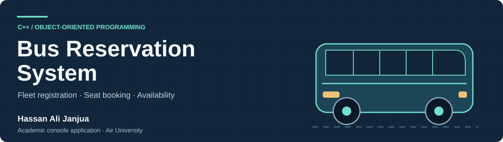
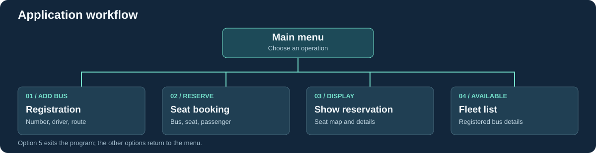
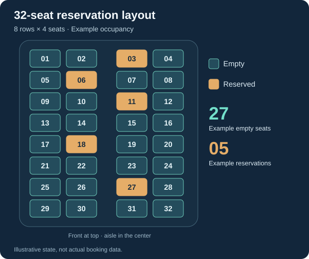
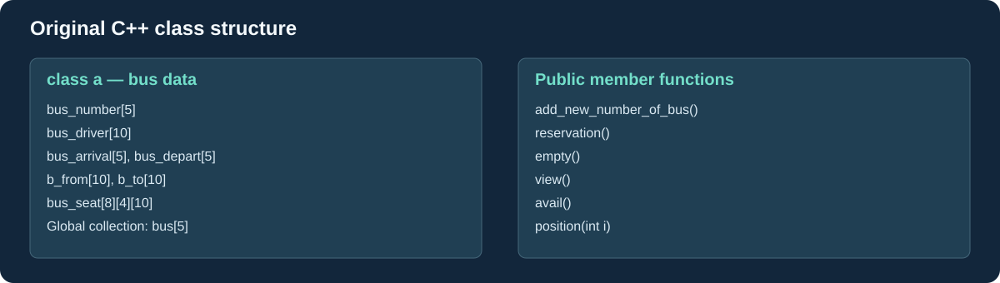

<div align="center">




**Hassan Ali Janjua · Mechatronics Engineering · Air University, Islamabad**

[Overview](#the-idea-behind-this-project) · [Booking workflow](#booking-workflow) · [Seat layout](#seat-layout) · [Class design](#class-design) · [Getting started](#getting-started)

</div>


## The idea behind this project

I built this console application to explore object-oriented programming through a familiar real-world problem: reserving a seat on a bus.

The idea was to bring bus registration, route information, passenger bookings and seat availability into one menu-driven program. Rather than working with independent programming exercises, I wanted the different functions to interact with a common bus record.

The project gave me practical experience with classes, member functions, arrays, string comparison and managing program state.

## Booking workflow



The user can register a bus, reserve a seat, display its reservation information or browse registered buses. The fifth menu option exits the application.

### 01 / Register a bus

I started by defining the information needed for each bus: its number, driver, arrival and departure times, and origin and destination. After registration, the program initializes the seat array with the value `Empty`.

| Bus information | Stored details |
| --- | --- |
| Identity | Bus number and driver name |
| Schedule | Arrival and departure time |
| Route | Origin and destination |
| Reservations | 32 seat entries |

### 02 / Reserve a seat

The reservation function searches for the requested bus number, asks for a seat number and then stores the passenger's name if the seat is available. The program attempts to reject an already occupied seat.

<details>
<summary><b>Explore the booking logic</b></summary>

The original implementation uses character arrays and `strcmp()` to compare bus numbers and seat status. It intends to map the chosen seat number to a row and column in the two-dimensional seat layout.

For a zero-based array, the correct mapping is:

```cpp
// Correct mapping for a seat number in the range 1–32.
int row = (seatNumber - 1) / 4;
int column = (seatNumber - 1) % 4;
```

This is the mapping I would use in a revised implementation; the original source uses a different expression that can access an invalid index, particularly at seats divisible by four.

[View the original C++ source](Bus%20Reservation%20System.cpp) · [Implementation notes](docs/implementation.md)

</details>

## Seat layout

The bus is represented by eight rows and four seats per row, making 32 seats in total. I used the seat matrix to connect the reservation process to the console display.

<table>
<tr>
<td width="55%" align="center"><br><sub>Illustrative booking state, not recorded passenger data.</sub></td>
<td width="45%" valign="top">

<b>03 / Show reservations</b>

<br><br>
Display the selected bus and route details.<br><br>
Show the numbered seat layout and passenger names.<br><br>
Count the remaining empty seats.

<br><br>

<b>04 / Browse available buses</b>

<br><br>
List registered buses along with drivers, routes and schedules.

</td>
</tr>
</table>

The seat layout above illustrates the intended design. The original implementation contains indexing and shared-counter issues, so its availability output is not yet a reliable production booking system.

## Class design



I organized the application around a C++ class that holds bus details and reservation data. The class exposes separate member functions for registration, booking, seat initialization and display.

| Function | Responsibility |
| --- | --- |
| `add_new_number_of_bus()` | Register a new bus and initialize its seats |
| `reservation()` | Search for a bus and record a passenger booking |
| `empty()` | Initialize each seat as empty |
| `view()` | Show bus and reservation details |
| `position(int)` | Print the seat matrix and count empty entries |
| `avail()` | Display registered buses |

The original program uses a fixed array of five bus objects and stores passenger names in memory. There is no persistent database; records are lost when the process exits.

## What I learned

| Programming concept | How I applied it |
| --- | --- |
| Object-oriented programming | Bus data and member functions in one class |
| Multidimensional arrays | Eight-row, four-column seat organization |
| String handling | Bus lookup and passenger names |
| Loops and conditionals | Menu navigation, seat initialization and availability |
| Console formatting | Route details, reservation output and seat display |

Looking back, I would separate the fleet count from the seat count, use standard strings and containers, and validate every input before accessing an array. This was an early project in connecting object-oriented programming concepts to a complete console application.

## Getting started

The original source is available in [Bus Reservation System.cpp](Bus%20Reservation%20System.cpp).

```bash
git clone https://github.com/HassanAliJanjua03/Bus-Reservation-System.git
cd Bus-Reservation-System
```

The program was written for a Windows-style console and includes `conio.h` and `system("cls")`. With a compatible MinGW installation, the suggested build command is:

```bash
g++ -std=c++17 -Wall -Wextra "Bus Reservation System.cpp" -o bus_reservation.exe
```

Run it from PowerShell using ` .\bus_reservation.exe ` after building.

The source is preserved as coursework, not a verified production application. Review the [implementation notes](docs/implementation.md) before attempting to execute booking operations. Use fictional passenger data only. The original build and runtime behavior have not been tested for this documentation update.

## Repository structure

```text
Bus-Reservation-System/
├── Bus Reservation System.cpp
├── assets/
│   ├── cover.svg
│   ├── specifications.svg
│   ├── workflow.svg
│   ├── seat-layout.svg
│   └── class-design.svg
├── docs/
│   └── implementation.md
├── .gitignore
└── README.md
```

The graphics are illustrations based on the original code rather than screenshots of a verified execution.

---

<div align="center">

**Hassan Ali Janjua**

Mechatronics Engineering · C++ · Object-Oriented Programming

[My engineering portfolio](https://github.com/HassanAliJanjua03)

</div>
